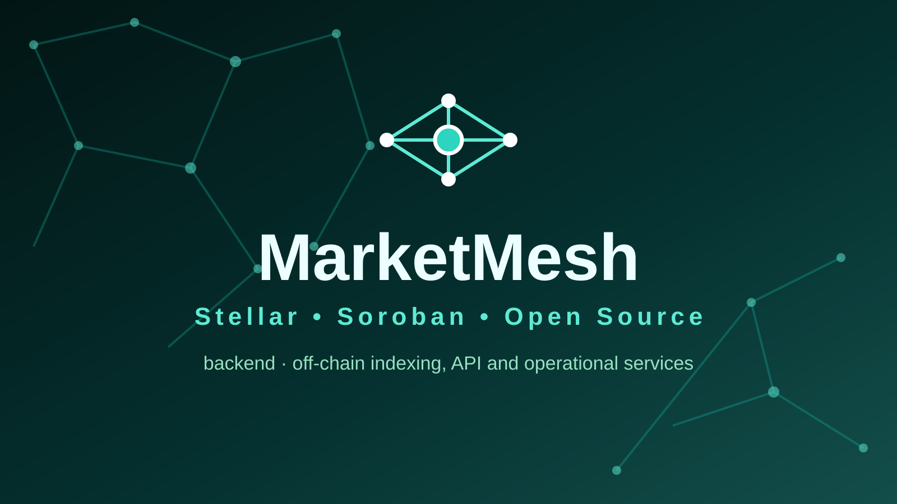
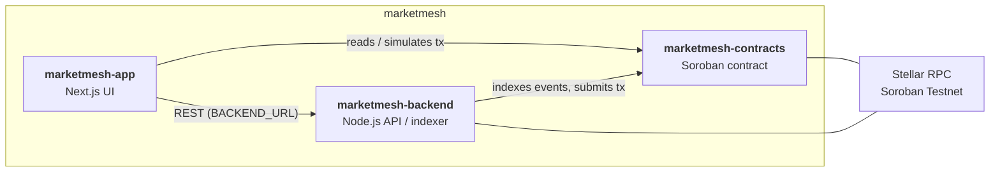

<p align="center">
  
</p>

<h1 align="center">MarketMesh — marketmesh-backend</h1>

<p align="center"><i>Non-custodial marketplace settlement and escrow tooling.</i></p>

<p align="center">
[](LICENSE)
[](.github/workflows/ci.yml)
[](#tech-stack)
[](#security)
</p>

## Why this exists

Non-custodial marketplace settlement and escrow tooling. This repository is the **off-chain indexing/API and operational services** of the three-repo **MarketMesh** system.

## Where it fits

- [`marketmesh-contracts`](../marketmesh-contracts) — on-chain Soroban state and authorization.
- [`marketmesh-app`](../marketmesh-app) — user-facing web application.
- [`marketmesh-backend`](../marketmesh-backend) — off-chain indexing/API and operational services. ← you are here



## Features

- Zero-framework Node.js HTTP server (`node:http`) for minimal overhead
- `GET /health` — service liveness probe returning `{ ok, service }`
- `GET /network` — reports the configured Stellar network
- JSON 404 handler for unknown routes
- Strict TypeScript built with `tsc`, run in dev via `tsx`
- Baseline test suite on the Node built-in test runner

## Tech stack

| Layer | Choice |
| --- | --- |
| Runtime | Node.js (native `node:http`) |
| Language | TypeScript 5.8 (ES2022, `NodeNext`, strict) |
| Dev runner | `tsx` 4.19 |
| Stellar | `@stellar/stellar-sdk` 17.2.1 |
| Tests | `node --test` |

## Project structure

```text
marketmesh-backend/
├── src/
│   ├── server.ts             # HTTP server entry point
│   └── server.test.ts        # baseline tests
├── assets/                   # logo.svg, social-preview.svg
├── docs/ARCHITECTURE.md
├── .env.example
├── package.json
├── tsconfig.json
└── .github/workflows/ci.yml
```

## Getting started

### Prerequisites

- Node.js 18+ and npm
- Access to Stellar Soroban Testnet RPC

### Installation

```bash
npm install
cp .env.example .env
```

### Environment variables

| Key | Example | Purpose |
| --- | --- | --- |
| `PORT` | `8787` | HTTP port the server binds to (defaults to `8787`) |
| `STELLAR_RPC_URL` | `https://soroban-testnet.stellar.org` | Soroban RPC endpoint used to reach the network |
| `DATABASE_URL` | *(empty)* | Database connection string — reserved; **not yet read by the code** |
| `CONTRACT_ID` | *(empty)* | Deployed contract id — reserved; **not yet read by the code** |

### Running locally

```bash
npm run dev   # tsx src/server.ts — serves /health and /network
```

### Testing

```bash
npm test      # node --test
```

### Building / deploying

```bash
npm run build # tsc → dist/
```

Deployment target (container, VM, serverless) is **TODO** — not defined yet.

## Roadmap

- Persist data via `DATABASE_URL` (key already in `.env.example`, unused)
- Indexer for on-chain events using `CONTRACT_ID`
- Authenticated API routes consumed by `marketmesh-app`
- OpenAPI spec + request validation

## Contributing

See [CONTRIBUTING.md](CONTRIBUTING.md) and [CODE_OF_CONDUCT.md](CODE_OF_CONDUCT.md).

## Security

See [SECURITY.md](SECURITY.md) for reporting guidelines.

> **Status: v0.1.0 — not audited, not production-ready.** Do not deploy with real funds.

## Maintainer

**Hikmaholadele** ([@Hikmaholadele](https://github.com/Hikmaholadele))


## License

Licensed under the [Apache License 2.0](LICENSE).
